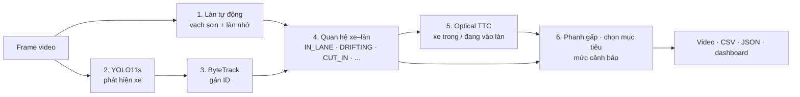

# Camera TTC — Báo cáo dự án cảnh báo va chạm phía trước

Nhóm HoHiHi · K4 Track 4 · cập nhật 17/10/2026

## 1. Tóm tắt

Camera TTC cảnh báo nguy cơ va chạm phía trước chỉ từ video một camera, không cần radar hay cảm biến khoảng cách. Hệ thống tự bám làn đang chạy, phát hiện và bám từng xe, rồi ước lượng **thời gian tới va chạm (TTC)** cho xe mục tiêu trong làn.

Hệ thống cảnh báo bốn tình huống:

- Xe phía trước trong làn tiến gần: TTC ≤ 3 s là cảnh báo, ≤ 1,5 s là nguy cấp.
- Xe phía trước **phanh gấp**.
- Xe làn bên **có dấu hiệu sang làn** mình.
- Xe làn bên **cắt làn hoặc tạt đầu** bất ngờ.

Kết quả chính:

- **6/6 kịch bản** nhiều xe đạt yêu cầu khi chạy YOLO và tracking thật với làn tự động.
- **0 cảnh báo giả** trên 42 giây dashcam thật (Udacity).
- 53/53 unit test đạt.
- Trên GPU RTX 3050 Laptop, pipeline nhanh hơn CPU khoảng 3,5 lần.

Khả năng bắt đúng các tình huống nguy hiểm mới được kiểm chứng trên video tổng hợp. Chưa có video thật chứa cảnh cắt làn hay phanh gấp để đo.

## 2. Bài toán và phạm vi

Mục tiêu là cảnh báo sớm nguy cơ va chạm phía trước từ video camera đặt sau kính lái, trong khuôn khổ hackathon và không huấn luyện mô hình mới.

- **Đầu vào:** video dashcam hoặc video tải lên. Camera gắn cố định, gần giữa xe, không zoom.
- **Đầu ra:** video có chú thích, CSV từng frame, summary JSON, lịch sử làn và biểu đồ TTC. Kết quả xem trực tiếp trên dashboard web cục bộ.
- **Không đo** khoảng cách theo mét hay tốc độ tuyệt đối. TTC là thời gian, tính từ tốc độ ảnh xe phình to.
- **Không điều khiển xe:** hệ thống chỉ cảnh báo, không phanh.

Dự án bắt đầu với đề tài cảnh báo người đi bộ bước vào vùng xe chạy, sau đó chuyển sang TTC với xe phía trước. Khung detection, tracking, lịch sử một giây và xác nhận nhiều frame được giữ lại. Bản hiện tại chỉ xét ô tô, xe máy, xe buýt và xe tải, không xét người đi bộ.

## 3. Kiến trúc pipeline

Mỗi frame đi qua sáu bước; bước 4 chạy trước bước TTC để quyết định xe nào được tính TTC.



| Thành phần | File |
|---|---|
| Chạy pipeline, vẽ, xuất file | `collision_warning/__main__.py` |
| Bám làn bằng CV cổ điển | `collision_warning/lanes.py` |
| Optical TTC theo từng track | `collision_warning/core.py` |
| Quan hệ xe–làn, cắt làn, phanh gấp, chọn mục tiêu | `collision_warning/scene.py` |
| Dashboard (FastAPI + giao diện) | `collision_warning/web.py`, `ui/` |
| Cấu hình ByteTrack | `collision_warning/trackers/bytetrack.yaml` |

## 4. Bám làn tự động

Làn mặc định được tìm tự động từ vạch trắng/vàng; chỉ khi truyền `--zone` mới dùng vùng vẽ tay.

1. **Tìm vạch:** lọc màu trắng/vàng, che vùng có xe, Hough để khởi tạo, dò theo dải ảnh, khớp đường cong bậc hai, loại điểm ngoại lai, làm mượt theo thời gian.
2. **Kéo dài về điểm tụ:** bộ tìm vạch chỉ thấy phần đường gần (từ khoảng 60% chiều cao ảnh). Biên làn được kéo dài thẳng lên phía điểm tụ để xếp được xe phía trước ở xa vào làn.
3. **Làm mượt thêm** (0,3 s) trước khi tính vị trí xe so với làn. Không có bước này, làn rung từng frame trông như mọi xe đều đang đi ngang.
4. **Khi mất vạch:** dùng lại làn vừa xác nhận tối đa 2 s (vạch thường bị che đúng lúc có xe tạt vào), sau đó dùng hành lang mặc định trước camera. TTC không bị tắt. `--lane-fallback none` trở về cách cũ (mất làn thì ngừng TTC).
5. **Tốc độ:** tìm làn chạy trên ảnh thu nhỏ còn 960 px chiều rộng (`--lane-width`).

| Độ rộng ảnh tìm làn | Thời gian | Frame bắt được làn (dashcam 720p, 250 frame) |
|---|---|---|
| 640 | 27 ms | 123 |
| 800 | 37 ms | 156 |
| **960 (mặc định)** | **50 ms** | **170** |
| 1280 (gốc) | 89 ms | 195 |

Trên toàn bộ 30 s dashcam cao tốc, mức 960 px bắt được làn ở 729/750 frame, gần bằng độ phân giải gốc (734/750).

## 5. Detection và tracking

YOLO11s và ByteTrack được chọn sau khi so sánh trên dashcam thật; chưa có nhãn ground truth nên các chỉ số dưới đây là gián tiếp.

| Cấu hình (12 s, CPU) | Xe bám liên tục ≥ 1 s (cao tốc) | ID / độ dài trung bình (giao thông) | FPS |
|---|---|---|---|
| YOLO11n + ByteTrack | 1 | 4 ID / 91 frame | 17–21 |
| **YOLO11s + ByteTrack** | **6** | **3 ID / 111 frame** | 10–11 |
| YOLO11s + BoT-SORT | 6 | 3 ID / 111 frame | 8–9 |

- **NMS không phân lớp:** trước đó một xe bị nhận đồng thời là "bus" và "truck", sinh ID ma và làm mục tiêu nhảy qua lại.
- **ByteTrack giữ ID 60 frame** khi xe bị che, ví dụ xe phía trước bị xe cắt làn che khuất.
- **Giữ track 0,3 s** khi detector bỏ sót vài frame, để lịch sử TTC không bị xóa.
- Track phải tồn tại ít nhất 3 frame mới được chọn làm mục tiêu.

## 6. Phương pháp TTC và các tình huống nguy hiểm

### Optical TTC

Với camera pinhole, chiều rộng ảnh của xe `w = f·W/Z`, nên `1/w` tỉ lệ thuận với khoảng cách Z. Nếu tốc độ tiếp cận không đổi, `1/w` giảm tuyến tính theo thời gian và chạm 0 lúc va chạm:

```
q(t) = 1/w(t) = a + b·t        (hồi quy trên ~1 giây lịch sử)
TTC  = -q_hiện_tại / b
```

Cách này không cần biết tiêu cự, kích thước xe hay tốc độ. TTC chỉ được tính khi bbox to ra đủ rõ (≥ 2%/s), không bị cắt mép ảnh, không đổi tỉ lệ khung đột ngột và đường hồi quy khớp tốt.

### Quan hệ xe–làn

Vị trí của xe so với làn được đo bằng **mép bbox phía làn mình**, tính theo bề rộng làn. Nhờ vậy xe song song bị cắt ở mép ảnh vẫn đo được.

| Quan hệ | Điều kiện |
|---|---|
| `IN_LANE` | Điểm giữa đáy bbox nằm trong làn |
| `CUT_IN` | Đã lấn ≥ 15% bề rộng làn khi đang di chuyển ngang, hoặc dự báo vào làn trong 1 s |
| `ENCROACHING` | Đè lên làn ≥ 30% nhưng không di chuyển ngang |
| `DRIFTING` | Ở làn bên, trôi dần vào trong (≥ 0,08 bề rộng làn/s), dự báo vào làn trong 3 s |
| `ADJACENT` | Ở làn bên, không có dấu hiệu sang làn |
| `FAR` | Quá xa, ngoài phần làn kéo dài |

Chuyển sang quan hệ nguy hiểm hơn cần 2 frame xác nhận; trở về mức an toàn cần 3 frame.

### Bốn tình huống cảnh báo

| Tình huống | Cách nhận biết | Mức |
|---|---|---|
| Xe trong làn tiến gần | TTC của xe mục tiêu | WARNING ≤ 3 s, CRITICAL ≤ 1,5 s |
| Xe trước phanh gấp | TTC giảm nhanh hơn 1,3 s mỗi giây (tốc độ không đổi thì giảm đúng 1 s/s) → `BRAKING`; TTC tính lại theo mô hình gia tốc không đổi | Theo TTC đã tính lại, tối thiểu WARNING |
| Xe làn bên có dấu hiệu sang làn | `DRIFTING` | WARNING khi xe không quá xa |
| Xe cắt làn / tạt đầu | `CUT_IN`; xe này lập tức thành mục tiêu và được tính TTC | CRITICAL khi gần, WARNING khi xa |

**Xe mục tiêu** là xe gần nhất (đáy bbox thấp nhất) đang ở `IN_LANE`, `CUT_IN` hoặc `ENCROACHING`.

**Chống cảnh báo giả:**

- Xe bị cắt ở mép ảnh (thường là xe đang vượt) chỉ được tính `CUT_IN` khi đã thực sự lấn vào làn, vì bbox của nó lớn dần vào trong khi xe hiện ra.
- Chỉ dự báo vào làn khi xe cách làn ≤ 0,5 bề rộng làn và không ở sát điểm tụ.
- Bỏ qua tốc độ ngang phi thực tế (> 3 bề rộng làn/s), vì đó là do làn rung chứ không phải xe di chuyển.

## 7. Kết quả kiểm chứng

### Sáu kịch bản nhiều xe (`tools/run_scene_demo.py`)

Video tổng hợp từ ảnh xe buýt dán theo phối cảnh trên đường có vạch sơn. YOLO11s, ByteTrack và làn tự động đều chạy thật.

| Kịch bản | Kết quả |
|---|---|
| `cut_in`: xe làn bên cắt vào giữa mình và xe trước | PASS. `CUT_IN` sớm 0,53 s trước khi tâm xe vào làn; mục tiêu chuyển sang xe mới |
| `parallel_cut_in`: xe sát bên (bị cắt mép ảnh) tạt vào | PASS. `CUT_IN CRITICAL` sớm 0,13 s; không cảnh báo khi xe chỉ chạy song song |
| `braking`: xe trước phanh gấp | PASS. Cảnh báo lúc 2,53 s; TTC tốc độ không đổi cảnh báo lúc 2,80 s. CRITICAL: 2,53 s so với 3,47 s |
| `lane_drift`: xe làn bên trôi dần sang | PASS. `DRIFTING` sớm 3,8 s trước khi tâm xe vào làn, sau đó `CUT_IN` |
| `sudden_cut_in`: xe gần tạt vào rồi phanh | PASS. `CUT_IN CRITICAL` sớm 0,13 s; xe vừa tạt vào có TTC |
| `parallel_hold`: xe song song giữ làn | PASS. Không cảnh báo |

### Ba kịch bản TTC cơ bản (`tools/run_demo.py`)

Xe tiến gần / giữ khoảng cách / đi xa dần: cả 3 PASS. Ở kịch bản tiến gần có TTC đáp án; khi TTC thật dưới khoảng 3 s, sai số còn 0,1–0,4 s. Khi xe còn xa, TTC bị ước lượng dài hơn thực tế khoảng 25–30%.

### Dashcam thật (Udacity CarND)

| Clip | Thời lượng | Làn tìm được / làn nhớ | Cảnh báo |
|---|---|---|---|
| Cao tốc 1280×720 | 30 s, 750 frame | 729 / 21 | 0 |
| Giao thông 960×540 | 12 s, 180 frame | 163–175 / 5–17 | 0 |

Lần chạy đầu trên clip cao tốc cho **7 cảnh báo cắt làn giả**: làn tự động rung khiến xe ở xa và xe cách một làn trông như đang đi ngang vào. Sau khi thêm làm mượt làn và các điều kiện dự báo (mục 6), số cảnh báo giả về 0. Đoạn dữ liệu thật gây lỗi được lưu thành test hồi quy (`tests/data/highway_lane_jitter.json`); test này đã được xác nhận là fail với logic cũ.

### Unit test

53/53 test đạt: TTC tham chiếu, nhiễu, cắt mép ảnh, mất track, quan hệ xe–làn, kéo dài làn, phanh gấp, sang làn, tạt đầu, làn rung, CLI, dashboard và biểu đồ.

## 8. Hiệu năng

| Cấu hình (dashcam cao tốc 1280×720) | FPS xử lý |
|---|---|
| CPU (Ryzen 7 5800H) | 2,6 |
| GPU RTX 3050 Laptop 4 GB, tìm làn 640 px | 9,2 |
| GPU RTX 3050 Laptop, tìm làn 960 px | 5,1 (đo khi dashboard đang khởi động cùng lúc, cần đo lại) |

Thời gian mỗi frame trên GPU khi chạy ổn định: YOLO11s + ByteTrack khoảng **37 ms**, tìm làn trên CPU **50 ms** (960 px), vẽ và ghi video khoảng 15 ms. FP16 không nhanh hơn trên GPU này. Bước tìm làn hiện là nút thắt; nếu cần nhanh hơn thì dùng `--lane-width 640` hoặc `--model yolo11n.pt`.

`--device auto` tự dùng GPU CUDA khi PyTorch có CUDA, nếu không thì dùng CPU. Dashboard hiển thị thiết bị đang dùng.

## 9. Giới hạn và hướng phát triển

**Giới hạn:**

- Chưa có video thật chứa cảnh cắt làn hay phanh gấp, nên độ chính xác cảnh báo trên đường thật chưa đo được.
- Chưa có nhãn ground truth để công bố mAP, IDF1 hay sai số TTC trên dữ liệu thật.
- TTC giả định kích thước và hướng xe ổn định; sai khi xe trước vào cua, bị che, hoặc camera rung/zoom. Khi xe còn xa, TTC bị ước lượng dài hơn thực tế.
- Xe song song tạt đầu đột ngột chỉ được báo sớm khoảng 0,1 s, vì xe ở mép ảnh phải thực sự lấn vào làn mới được tính.
- Bám làn bằng CV cổ điển cho ban ngày; cảnh đêm, mưa, vạch mờ, đường cong gắt hoặc camera lệch tâm có thể làm sai làn.
- Chưa đạt thời gian thực ở 720p (khoảng 5–9 FPS trên RTX 3050).
- Không xét người đi bộ; không có khoảng cách theo mét; không điều khiển phanh.

**Hướng phát triển:**

1. Thu thập hoặc gán nhãn video thật có cắt làn, phanh gấp để đo precision/recall và thời gian cảnh báo sớm.
2. Thay bộ tìm làn bằng mô hình học sâu và chạy trên GPU để vừa nhanh hơn vừa ổn định hơn.
3. Thêm lớp người đi bộ và xe máy len lỏi vào cùng logic quan hệ làn.
4. Kết hợp tốc độ xe (CAN/GPS) hoặc radar để có khoảng cách và gia tốc thật.

## 10. Cách chạy demo

Dashboard (Windows, môi trường đã cài sẵn):

```powershell
.\.venv-win\Scripts\python.exe -m collision_warning.web --open-browser
```

Mở http://127.0.0.1:8765, chọn video, giữ chế độ **Tự động · bám vạch làn** và nhấn **Phân tích video**. Các clip kịch bản nằm trong `outputs/scene-sample/` (tạo bằng `tools/prepare_scene_sample.py`).

Dòng lệnh:

```powershell
.\.venv-win\Scripts\python.exe -m collision_warning --source video.mp4 --output outputs/ket-qua.mp4
```

Kiểm chứng:

```powershell
.\.venv-win\Scripts\python.exe tools/run_scene_demo.py      # 6 kịch bản nhiều xe
.\.venv-win\Scripts\python.exe tools/run_demo.py            # 3 kịch bản TTC cơ bản
.\.venv-win\Scripts\python.exe -m unittest discover -s tests
```

Chi tiết tham số và trạng thái: xem `README.md`.
